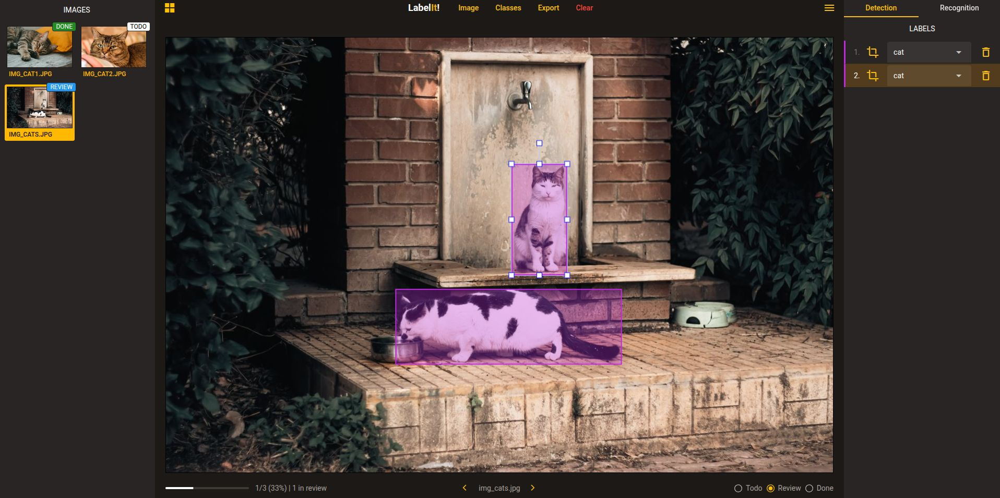

# LabelIt!

LabelIt! is a simple web application for preparing labels for image datasets. It supports image classification and drawing bounding boxes for object detection.

## About

This application was created as a university project.

**Author:** `Karol Nowak`

## User Interface

### Homepage


### Workspace



## Requirements

- Python 3.10 or newer
- pip
- Git

## Getting Started

Clone the repository and navigate to the project directory:

```bash
git clone <REPOSITORY_URL>
cd labelit
```

### Linux (Ubuntu)

```bash
python3 -m venv .venv
source .venv/bin/activate
python -m pip install -r requirements.txt
python main.py
```

### Windows (PowerShell)

```powershell
py -m venv .venv
.venv\Scripts\Activate.ps1
python -m pip install -r requirements.txt
python main.py
```

Open [http://localhost:8080](http://localhost:8080) in your browser. Stop the server by pressing `Ctrl+C` in the terminal.

To start the app again later, navigate to the project directory, activate the virtual environment, and run the app:

On Linux:

```bash
cd labelit
source .venv/bin/activate
python main.py
```

On Windows (PowerShell):

```powershell
cd labelit
.venv\Scripts\Activate.ps1
python main.py
```

## Supported File Types

- Images: `.jpg`, `.jpeg`, `.png`
- Classification labels: `.txt`
- Object annotations: `.csv`

## Technologies

- Python
- [NiceGUI](https://nicegui.io/)
- Pillow
- [Fabric.js](https://fabricjs.com/) (canvas for displaying and editing annotations)
