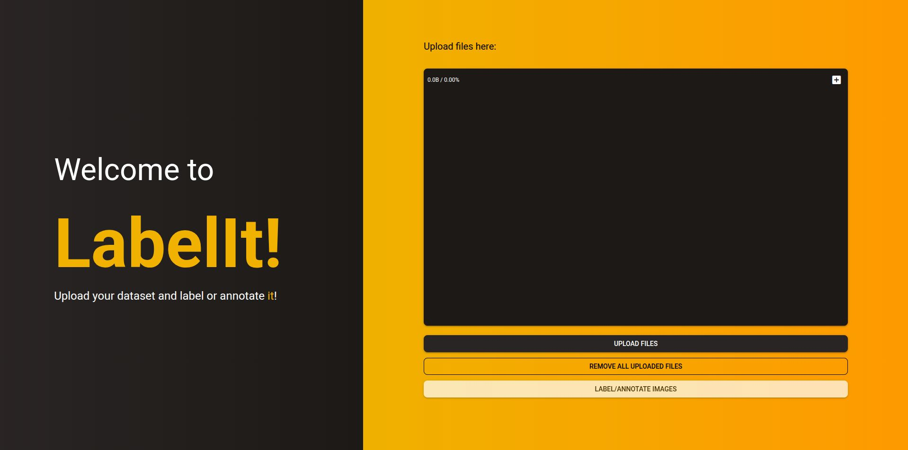

# LabelIt!

LabelIt! to prosta aplikacja webowa do przygotowywania etykiet dla zbiorów obrazów. Obsługuje klasyfikację obrazów oraz tworzenie ramek do detekcji obiektów.

## Interfejs użytkownika

### Homepage



### Workspace


> Dodaj zrzuty ekranu do folderu `screenshots/` pod nazwami `homepage.png` i `workspace.png`.

## Wymagania

- Python 3.10 lub nowszy
- pip
- Git

## Uruchomienie

Sklonuj repozytorium i przejdź do katalogu projektu:

```bash
git clone <URL_REPOZYTORIUM>
cd labelit
```

### Linux (Ubuntu)

```bash
python3 -m venv .venv
source .venv/bin/activate
python -m pip install -r requirements.txt
python main.py
```

### Windows (PowerShell)

```powershell
py -m venv .venv
.venv\Scripts\Activate.ps1
python -m pip install -r requirements.txt
python main.py
```

Otwórz [http://localhost:8080](http://localhost:8080) w przeglądarce. Serwer zatrzymasz skrótem `Ctrl+C` w terminalu.

Przy kolejnych uruchomieniach na Linuxie:

```bash
cd labelit
source .venv/bin/activate
python main.py
```

Na Windows (PowerShell) użyj:

```powershell
cd labelit
.venv\Scripts\Activate.ps1
python main.py
```

## Obsługiwane pliki

- Obrazy: `.jpg`, `.jpeg`, `.png`
- Etykiety klasyfikacji: `.txt`
- Adnotacje obiektów: `.csv`

## Technologie

- Python
- [NiceGUI](https://nicegui.io/)
- Pillow
- [Fabric.js](https://fabricjs.com/) (canvas do wyświetlania i edycji adnotacji)
